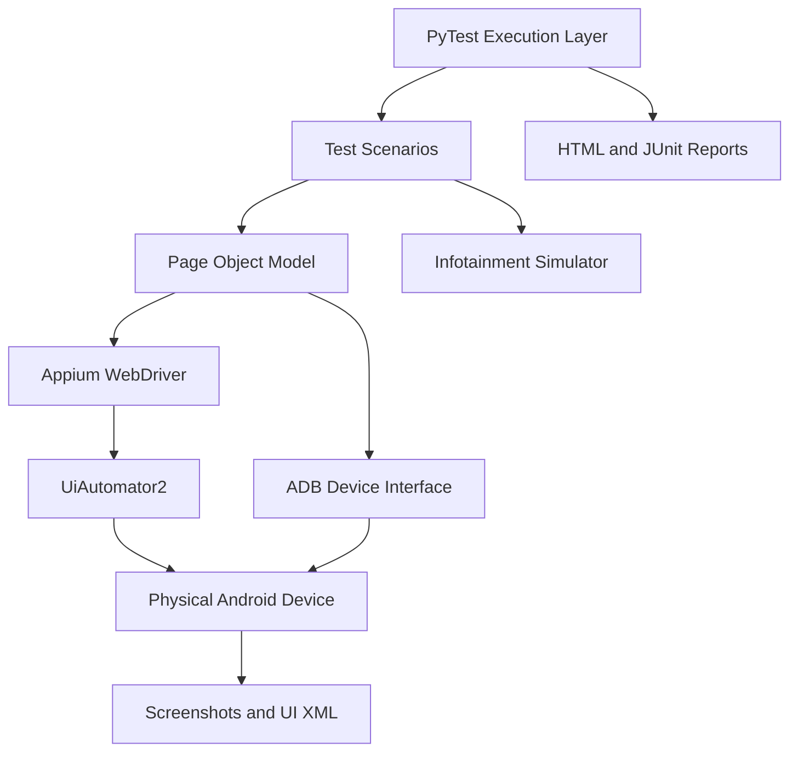

# Automotive Infotainment (IVI) Test Automation Framework


## Executive Overview

A modular Python-based test automation framework designed
for automotive infotainment (IVI) functional validation,
Android UI automation, device-level verification and
regression testing.

The framework combines Page Object Model (POM), PyTest,
Appium and Android Debug Bridge (ADB) to automate
infotainment-oriented workflows across simulated components
and a physical Android device.

The implementation focuses on maintainability, reusable
automation components, application-state synchronization,
failure analysis, device-state management and automated
test reporting.

This repository represents an independent technical
implementation of SDET and automotive test automation
engineering practices.

## Regression Execution Summary

| Metric | Result |
|---|---:|
| Total Test Cases | 69 |
| Passed | 67 |
| Failed | 0 |
| Errors | 0 |
| Skipped | 2 |
| Executed Test Pass Rate | 100% |
| Overall Passed Percentage | 97.10% |
| Execution Duration | 187.66 seconds |
| Execution Date | 25 November 2026 |

## Technology Stack

| Category | Technologies |
|---|---|
| Programming | Python |
| Test Framework | PyTest |
| Mobile Automation | Appium, UiAutomator2 |
| UI Interaction | Selenium WebDriver APIs |
| Device Communication | ADB |
| Design Pattern | Page Object Model |
| Reporting | PyTest HTML, JUnit XML |
| Diagnostics | Screenshots, UI XML, ADB |
| Version Control | Git, GitHub |
| Development | VS Code, macOS |
| Development Assistance | AI-assisted automation and debugging |

## Framework Architecture



### Architectural Principles

- Separation of test logic and UI interaction.
- Object-oriented reusable automation components.
- Explicit waits and application-state synchronization.
- Resource ID and accessibility-based element identification.
- Conditional execution based on environment prerequisites.
- Device-state restoration after configuration changes.
- Exception handling and Appium session cleanup.
- Diagnostic evidence collection for failure analysis.

## Functional Coverage

### 1. Infotainment System Validation

- Simulated system startup and power-state validation.
- Functional module accessibility.
- Simulated Bluetooth and media operations.
- Positive and negative scenario validation.
- System dependency and state-transition verification.

### 2. Bluetooth Automation

- Bluetooth adapter status verification.
- Bluetooth ON/OFF state-transition validation using ADB.
- Paired and available device section detection.
- Bluetooth Settings UI inspection.
- Original adapter-state restoration.
- Bluetooth UI hierarchy collection.

### 3. Media Playback Automation

Application under test: Spotify

- Application launch and foreground-state verification.
- Dynamic mini-player detection.
- Automatic full-screen player initialization.
- Play/Pause state-transition validation.
- Next Track interaction.
- Track metadata and title-change verification.
- UI hierarchy collection.
- Conditional Previous Track validation.

### 4. Navigation Automation

Application under test: Google Maps

- Application launch and UI readiness validation.
- Destination search and input handling.
- Search result verification.
- Directions screen validation.
- Dynamic destination selection.
- Transport mode selection.
- Alternate route identification and selection.
- Route information extraction.
- Screenshot and XML evidence collection.

Supported transport options:

- Driving
- Two-wheeler
- Public transport
- Walking

Driving and two-wheeler workflows have been exercised.
Public transport and walking require independent validation.

### 5. Phone Integration

Application under test: Samsung Phone

- Dialer application launch.
- Numeric keypad validation.
- Phone number entry.
- Digit deletion and number clearing.
- Call button availability.
- SIM environment verification.
- Screenshot evidence collection.

Actual telephone calls are intentionally excluded.

### 6. System Settings Validation

- Android version and device model verification.
- Battery status monitoring.
- Wi-Fi state validation.
- Airplane mode status verification.
- Screen brightness configuration validation.
- Screen timeout configuration validation.
- System Settings application launch.
- Restoration of modified configuration values.

## Engineering Challenges and Resolutions

### Application-State Management

Problem:

Appium sessions could inherit application states from
previous test executions, resulting in inconsistent
navigation and media player availability.

Resolution:

- Explicit application activation.
- Foreground package verification.
- Dynamic UI-state detection.
- Conditional navigation to the required screen.
- Explicit synchronization before functional assertions.

### Spotify Player Synchronization

Problem:

Spotify opened in its home screen with a mini-player
instead of the full-screen playback interface, causing
element detection timeouts.

Resolution:

- Analyzed Android UI hierarchy and accessibility attributes.
- Identified the mini-player resource ID.
- Implemented automatic player expansion.
- Added full-screen player readiness verification.
- Re-executed functional and regression scenarios.

### Bluetooth State Interpretation

Problem:

Android reported BLE_ON after Bluetooth was disabled,
making direct adapter-state comparisons unreliable.

Resolution:

- Inspected Bluetooth Manager output through ADB.
- Validated the explicit enabled/disabled property.
- Implemented state polling.
- Restored the original Bluetooth configuration after testing.

### Environment-Dependent Test Execution

Problem:

Spotify Previous Track validation produced inconsistent
results in the available playback environment.

Resolution:

- Preserved the original functional assertion.
- Introduced explicit conditional execution.
- Documented the scenario as unverified.
- Maintained transparent regression reporting.

Spotify account restrictions remain a possible but
unconfirmed cause of the failure.

## AI-Assisted Automation Engineering

AI coding assistance was utilized to support:

- Functional test scenario development.
- Python automation script generation and refinement.
- Page Object Model implementation.
- Appium locator troubleshooting.
- ADB output and UI hierarchy analysis.
- Exception and timeout investigation.
- Regression failure analysis.
- Technical documentation.

Generated automation was executed against the test
environment and evaluated using functional assertions,
execution logs and diagnostic evidence.

## Repository Structure

```text
automotive-infotainment-automation/
|
|-- pages/
|   |-- android_bluetooth_page.py
|   |-- spotify_media_page.py
|   |-- google_maps_page.py
|   |-- navigation_routes_page.py
|   |-- samsung_phone_page.py
|   `-- Additional page objects
|
|-- tests/
|   |-- Bluetooth validation
|   |-- Media playback validation
|   |-- Navigation validation
|   |-- Phone integration validation
|   |-- System settings validation
|   `-- Simulator and connectivity tests
|
|-- scripts/
|   `-- Diagnostic utilities
|
|-- reports/
|   |-- HTML regression reports
|   |-- JUnit XML reports
|   `-- Screenshots and UI hierarchies
|
|-- requirements.txt
|-- .gitignore
`-- README.md
```

Execution reports and device-specific diagnostic artifacts
are maintained locally to protect personal information.

## Test Environment

| Component | Configuration |
|---|---|
| Host | MacBook Air |
| Operating System | macOS |
| Physical Device | Samsung Galaxy Tab S10 FE+ |
| Device Model | SM-X626B |
| Android Version | 16 |
| Python | 3.14.6 |
| PyTest | 9.2.0 |
| Appium Server | 4.0.0 |
| Automation Driver | UiAutomator2 |
| Device Interface | USB / ADB |

## Environment Configuration

### Clone Repository

```bash
git clone https://github.com/komalreddysheru6-beep/automotive-infotainment-automation.git

cd automotive-infotainment-automation
```

### Configure Python Environment

```bash
python3 -m venv venv
source venv/bin/activate
python -m pip install -r requirements.txt
```

### Configure Appium

Ensure Node.js, Java, Android SDK, ADB and Appium
are installed and configured.

```bash
appium driver install uiautomator2
```

### Verify Device Connectivity

```bash
adb devices
```

```bash
export ANDROID_UDID="YOUR_DEVICE_SERIAL"
```

Some existing device-specific tests require updating
their configured device identifier.

### Start Appium Server

```bash
appium
```

Ensure the device is unlocked, USB debugging is enabled
and the required applications are installed.

## Test Execution

### Complete Regression Suite

```bash
python -m pytest tests/ -v -s
```

### Bluetooth Validation

```bash
python -m pytest tests/test_bluetooth_toggle.py -v -s
```

### Media Playback Validation

```bash
python -m pytest tests/test_spotify_play_pause.py -v -s
```

### Phone Integration Validation

```bash
python -m pytest tests/test_phone_integration.py -v -s
```

### System Settings Validation

```bash
python -m pytest tests/test_system_settings.py -v -s
```

### Interactive Navigation Validation

```bash
CUSTOM_NAVIGATION=1 python -m pytest tests/test_navigation_custom.py -v -s
```

### Conditional Previous Track Validation

```bash
SPOTIFY_PREMIUM=1 python -m pytest tests/test_spotify_previous_track.py -v -s
```

Enable this scenario only when unrestricted playback
functionality has been confirmed.

## Automated Reporting

```bash
mkdir -p reports

python -m pytest tests/ -v -s \
--html=reports/final_regression_report.html \
--self-contained-html \
--junitxml=reports/final_regression.xml
```

Reporting capabilities:

- HTML execution summaries.
- Individual test execution results.
- Execution duration tracking.
- Failure and skip information.
- Machine-readable JUnit XML.
- Device screenshots.
- Android UI hierarchy evidence.

## Quality Engineering Practices

- Functional and regression test automation.
- Positive and negative test scenarios.
- State-transition validation.
- Reusable automation architecture.
- UI and device-level verification.
- Root cause investigation.
- Environment prerequisite management.
- Test isolation and resource cleanup.
- Regression execution analysis.
- Git-based source control.
- AI-assisted automation development.

## Scope and Known Limitations

The current framework uses a physical Android tablet
as an infotainment-oriented validation environment.

It does not represent a production automotive head unit
or an Android Automotive OS implementation.

- Physical ECU and vehicle network communication
  are outside the implemented scope.
- CAN, LIN, UDS and Automotive Ethernet validation
  are not implemented in this repository.
- Actual Bluetooth pairing, audio streaming and
  hands-free calling are not verified on hardware.
- Bluetooth adapter toggling is verified through ADB;
  Bluetooth switch UI interaction remains unverified.
- Navigation covers destination and route workflows,
  not live vehicle navigation.
- Some destination selection requires manual input.
- Actual telephone calls are excluded.
- Spotify Previous Track remains unverified.
- Spotify XML testing verifies hierarchy capture,
  not complete playback functionality.
- System settings tests validate configured values,
  not physical display behaviour.
- Some device identifiers and locators require
  device-specific configuration.

## Engineering Roadmap

- Centralized environment configuration.
- Shared PyTest fixtures and session management.
- Data-driven and parameterized test execution.
- Automated failure screenshot collection.
- Allure reporting integration.
- Jenkins and GitHub Actions CI/CD integration.
- Python-based CAN simulation.
- UDS diagnostic validation.
- Automotive Ethernet communication testing.
- Physical infotainment head unit integration.
- Hardware-in-the-loop test environment integration.

## Author

**Komal Reddy**

Python Automation Engineer | SDET

Technical Focus:

Python | PyTest | Appium | Selenium | Playwright |
Automotive Infotainment | API Testing |
Regression Automation | AI-Assisted Testing

GitHub:
https://github.com/komalreddysheru6-beep

---

Independent SDET engineering portfolio demonstrating
automation architecture, automotive domain-oriented
validation, real-device testing and regression engineering.
